# Native TypeScript Graphics: DirectX 12 and Vulkan samples in TypeScript

**Real-time 3D graphics, ray tracing, mesh shaders and GPU compute written in TypeScript and
compiled to native code.** 112 graphics samples for **D3D12 and Vulkan** (and Vulkan on
**Android**), built with [tslang](https://github.com/ASDAlexander77/TypeScriptCompiler), a native
TypeScript compiler (LLVM), on top of NVIDIA's [Donut](https://github.com/NVIDIA-RTX/Donut)
rendering framework and [NVRHI](https://github.com/NVIDIA-RTX/NVRHI).

The examples are ports of well-known samples from NVIDIA Donut-Samples, Khronos Vulkan-Samples,
Microsoft DirectX-Graphics-Samples, Xbox ATG Samples and NVIDIA DXR Tutorials: hardware ray tracing
(DXR, Vulkan ray tracing, ray queries, opacity micromaps, shader execution reordering), mesh and
task shaders, work graphs, variable rate shading, async compute, bindless resources, HDR,
order-independent transparency, tessellation, texture compression (BC, Basis Universal / KTX 2)
and more. No JavaScript engine, no WebGPU: the TypeScript is compiled ahead of time to an object
file and linked like C++.

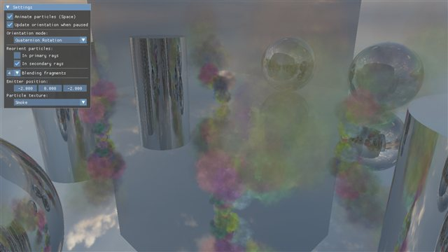

TypeScript is a trademark of Microsoft; this project is not affiliated with or endorsed by
Microsoft.

## Contents

- [Quick start](#quick-start)
- [Example gallery](#example-gallery)
  - [Donut-Samples ports](#donut-samples-ports)
  - [Vulkan-Samples ports](#vulkan-samples-ports)
  - [DirectX-Graphics-Samples ports](#directx-graphics-samples-ports)
  - [Xbox ATG Samples ports](#xbox-atg-samples-ports)
  - [NVIDIA DXR Tutorials port](#nvidia-dxr-tutorials-port)
  - [Original examples](#original-examples)
- [External assets](#external-assets)
- [Repository layout](#repository-layout)
- [How the TypeScript build works](#how-the-typescript-build-works)
- [Calling NVRHI directly](#calling-nvrhi-directly)
- [Memory model](#memory-model)
- [Android](#android)
- [Tests](#tests)
- [Credits](#credits)

## Quick start

Requirements: Windows with Visual Studio 2022 (C++), CMake 3.26+ and Ninja (the `TSLANG`
language needs the Ninja generator), the Vulkan SDK
(`VULKAN_SDK`, for DXC), Python 3, and a D3D12 or Vulkan GPU (ray tracing and mesh shader examples
need hardware that supports them). tslang is found on the `PATH` or in `tools/tslang`; if it isn't
there, configure downloads the pinned release from GitHub. Build from a *x64 Native Tools* / Developer
PowerShell prompt so the MSVC linker is found:

```
git clone --recursive https://github.com/ASDAlexander77/native_ts_graphics.git
cd native_ts_graphics
cmake --preset default
cmake --build --preset default
```

`release` builds into `build-release`. The executables land in `build/bin`, next to their
shaders and media:

```
build/bin/basic_triangle.exe -dx12
build/bin/rt_particles.exe -vk
```

`-dx12`, `-vk` (and `-dx11` where an example supports it) pick the graphics API, `-debug` enables
the debug and validation layers. `dlss` / `release-dlss` add DLSS to `feature_demo`.

## Example gallery

Every example is a single TypeScript file in [`examples/`](examples) with its HLSL shaders in
[`shaders/`](shaders). Click a screenshot to open its source. Screenshots are taken with
`tools/capture_screenshots.ps1` on D3D12 (or Vulkan for Vulkan-only examples).

### Donut-Samples ports

Ported from [NVIDIA Donut-Samples](https://github.com/NVIDIA-RTX/Donut-Samples).

<table>
<tr><td valign="top" width="33%"><a href="examples/basic_triangle.ts"></a><br><a href="examples/basic_triangle.ts"><b>Basic Triangle</b></a><br><sub>Hello world: one vertex-colored triangle drawn with D3D12 or Vulkan.</sub></td><td valign="top" width="33%"><a href="examples/vertex_buffer.ts">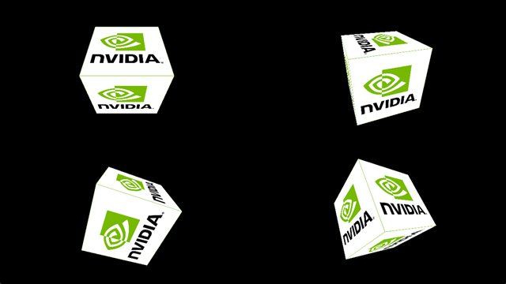</a><br><a href="examples/vertex_buffer.ts"><b>Vertex Buffer</b></a><br><sub>Textured cubes drawn from vertex and index buffers.</sub></td><td valign="top" width="33%"><a href="examples/deferred_shading.ts">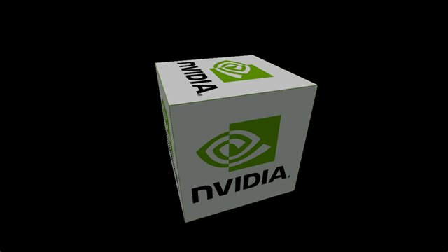</a><br><a href="examples/deferred_shading.ts"><b>Deferred Shading</b></a><br><sub>Donut's G-buffer fill and deferred lighting passes.</sub></td></tr>
<tr><td valign="top" width="33%"><a href="examples/threaded_rendering.ts">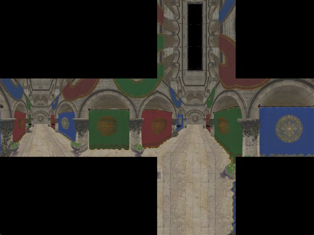</a><br><a href="examples/threaded_rendering.ts"><b>Threaded Rendering</b></a><br><sub>Sponza rendered into the six faces of a cube map, each face recorded on its own worker thread.</sub></td><td valign="top" width="33%"><a href="examples/async_compute.ts">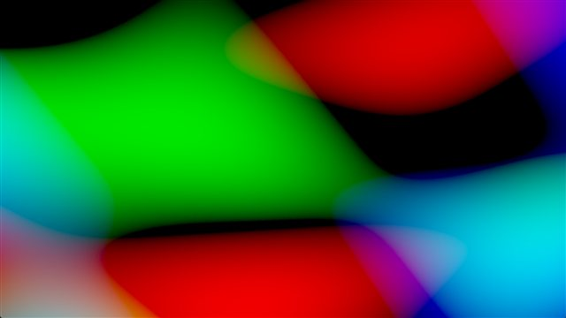</a><br><a href="examples/async_compute.ts"><b>Async Compute</b></a><br><sub>A compute-queue worker thread animates textures that the render thread shows.</sub></td><td valign="top" width="33%"><a href="examples/meshlets.ts">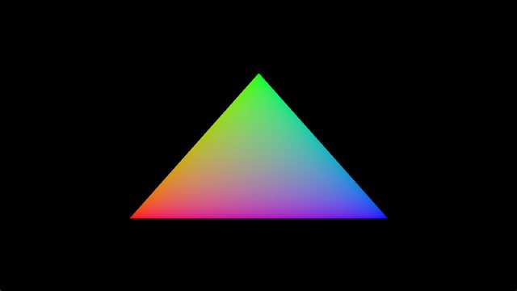</a><br><a href="examples/meshlets.ts"><b>Meshlets</b></a><br><sub>Geometry drawn by mesh shaders from meshlets.</sub></td></tr>
<tr><td valign="top" width="33%"><a href="examples/shader_specializations.ts">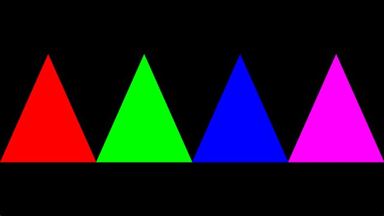</a><br><a href="examples/shader_specializations.ts"><b>Shader Specializations</b></a><br><sub>Vulkan specialization constants picking shader variants.</sub></td><td valign="top" width="33%"><a href="examples/rt_triangle.ts">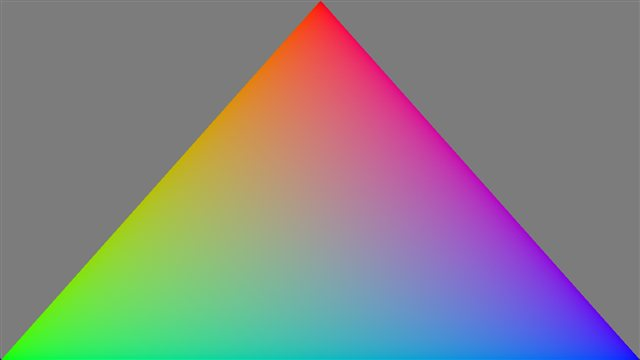</a><br><a href="examples/rt_triangle.ts"><b>Ray Traced Triangle</b></a><br><sub>The minimal hardware ray tracing pipeline (DXR / Vulkan RT).</sub></td><td valign="top" width="33%"><a href="examples/rt_shadows.ts">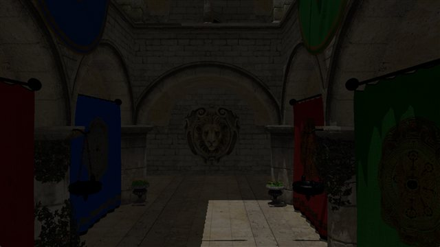</a><br><a href="examples/rt_shadows.ts"><b>Ray Traced Shadows</b></a><br><sub>Ray traced sun shadows on Sponza.</sub></td></tr>
<tr><td valign="top" width="33%"><a href="examples/rt_reflections.ts">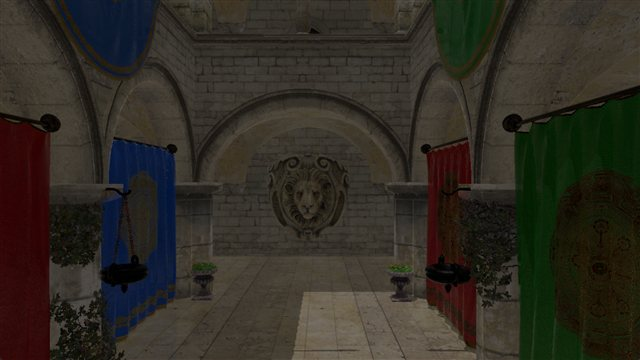</a><br><a href="examples/rt_reflections.ts"><b>Ray Traced Reflections</b></a><br><sub>Ray traced shadows and reflections on Sponza (D3D12).</sub></td><td valign="top" width="33%"><a href="examples/rt_bindless.ts">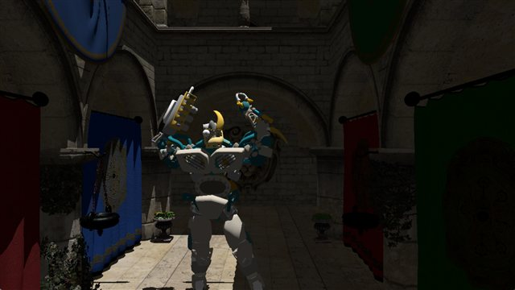</a><br><a href="examples/rt_bindless.ts"><b>Bindless Ray Tracing</b></a><br><sub>Bindless ray tracing of an animated scene, by pipeline or inline ray queries.</sub></td><td valign="top" width="33%"><a href="examples/rt_particles.ts"></a><br><a href="examples/rt_particles.ts"><b>Ray Traced Particles</b></a><br><sub>Billboard and intersection particles traced with ray queries and multi-layer alpha blending.</sub></td></tr>
<tr><td valign="top" width="33%"><a href="examples/bindless_rendering.ts">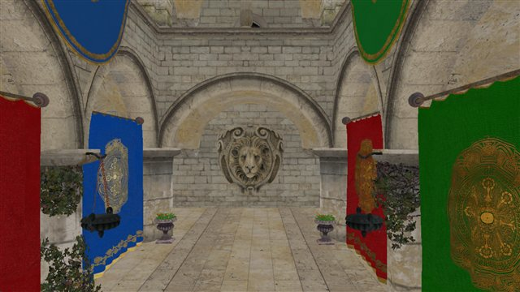</a><br><a href="examples/bindless_rendering.ts"><b>Bindless Rendering</b></a><br><sub>Sponza drawn with no vertex buffers bound: vertices and textures fetched bindlessly.</sub></td><td valign="top" width="33%"><a href="examples/variable_shading.ts">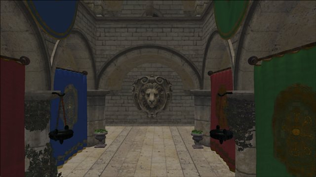</a><br><a href="examples/variable_shading.ts"><b>Variable Rate Shading</b></a><br><sub>Sponza with a compute-generated shading rate surface.</sub></td><td valign="top" width="33%"><a href="examples/work_graphs.ts">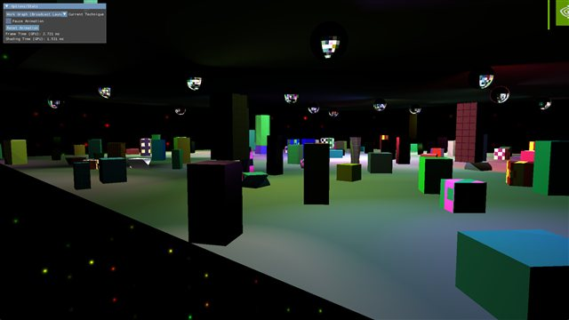</a><br><a href="examples/work_graphs.ts"><b>Work Graphs</b></a><br><sub>Deferred shading driven by a D3D12 work graph (shader model 6.8).</sub></td></tr>
<tr><td valign="top" width="33%"><a href="examples/feature_demo.ts">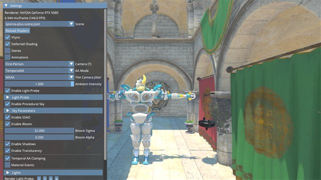</a><br><a href="examples/feature_demo.ts"><b>Feature Demo</b></a><br><sub>Donut's full renderer: deferred/forward, cascaded shadows, SSAO, TAA, bloom, tone mapping, light probes.</sub></td><td valign="top" width="33%"><a href="examples/headless.ts"><b>Headless</b></a><br><sub>Compute only, no window: runs a compute shader and checks its result (no screenshot).</sub></td></tr>
</table>

### Vulkan-Samples ports

Ported from [Khronos Vulkan-Samples](https://github.com/KhronosGroup/Vulkan-Samples).

<table>
<tr><td valign="top" width="33%"><a href="examples/compute_nbody.ts">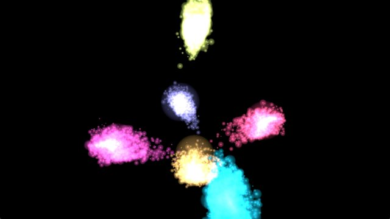</a><br><a href="examples/compute_nbody.ts"><b>Compute N-Body</b></a><br><sub>An N-body gravity simulation in compute shaders, drawn as additive sprites.</sub></td><td valign="top" width="33%"><a href="examples/terrain_tessellation.ts">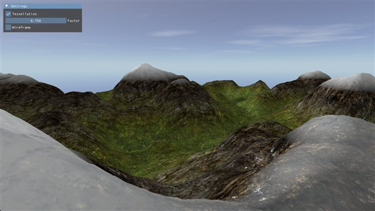</a><br><a href="examples/terrain_tessellation.ts"><b>Terrain Tessellation</b></a><br><sub>A heightmap terrain of patches tessellated by their size on screen.</sub></td><td valign="top" width="33%"><a href="examples/instancing.ts">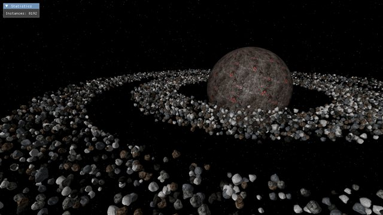</a><br><a href="examples/instancing.ts"><b>Instancing</b></a><br><sub>Thousands of rocks around a planet in one instanced draw.</sub></td></tr>
<tr><td valign="top" width="33%"><a href="examples/hdr.ts">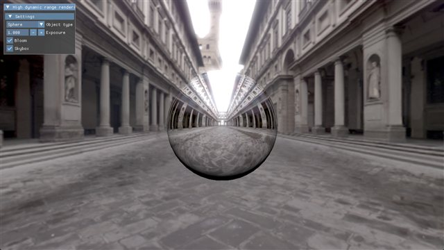</a><br><a href="examples/hdr.ts"><b>HDR</b></a><br><sub>A reflective object in an HDR environment with exposure and two-pass bloom.</sub></td><td valign="top" width="33%"><a href="examples/ray_tracing_extended.ts">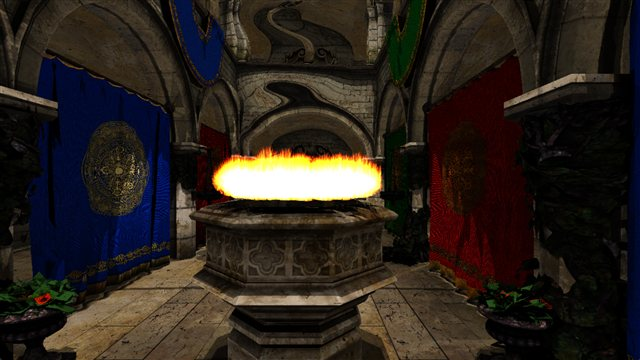</a><br><a href="examples/ray_tracing_extended.ts"><b>Ray Tracing Extended</b></a><br><sub>Sponza ray traced with shadows, AO, a refracting sheet and per-frame BLAS/TLAS updates.</sub></td><td valign="top" width="33%"><a href="examples/ray_tracing_invocation_reorder.ts">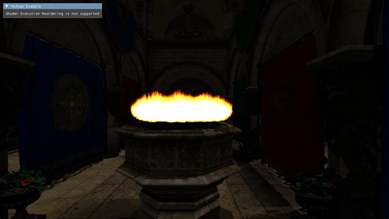</a><br><a href="examples/ray_tracing_invocation_reorder.ts"><b>Ray Tracing Invocation Reorder</b></a><br><sub>Shader execution reordering of primary rays (SM 6.9 hit objects / SPV_NV_shader_invocation_reorder).</sub></td></tr>
<tr><td valign="top" width="33%"><a href="examples/ray_tracing_position_fetch.ts">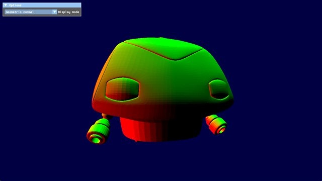</a><br><a href="examples/ray_tracing_position_fetch.ts"><b>Ray Tracing Position Fetch</b></a><br><sub>Closest-hit shaders reading vertex positions from the acceleration structure (Vulkan).</sub></td><td valign="top" width="33%"><a href="examples/ray_tracing_reflection.ts">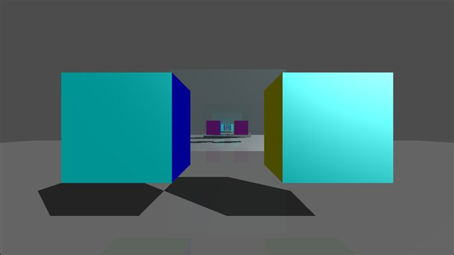</a><br><a href="examples/ray_tracing_reflection.ts"><b>Ray Tracing Reflection</b></a><br><sub>Cubes between two mirrors, reflection rays bounced up to 64 times.</sub></td><td valign="top" width="33%"><a href="examples/ray_queries.ts">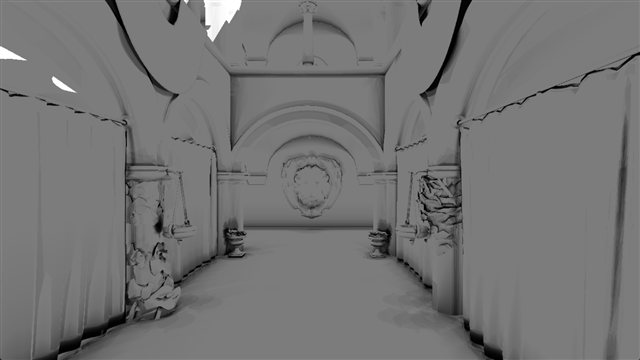</a><br><a href="examples/ray_queries.ts"><b>Ray Queries</b></a><br><sub>Rasterized Sponza shaded by inline ray queries: ambient occlusion and shadows.</sub></td></tr>
<tr><td valign="top" width="33%"><a href="examples/multi_draw_indirect.ts">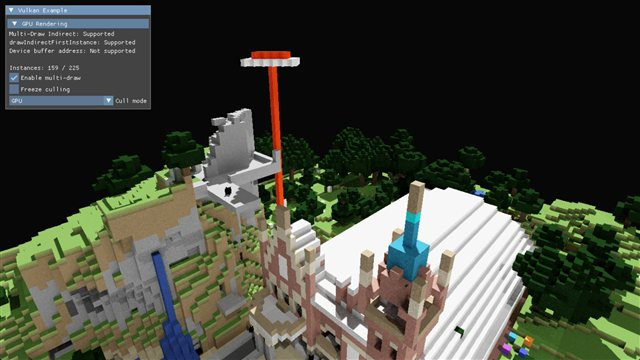</a><br><a href="examples/multi_draw_indirect.ts"><b>Multi-Draw Indirect</b></a><br><sub>225 meshes in one indirect draw, culled on the CPU or in a compute shader.</sub></td><td valign="top" width="33%"><a href="examples/async_compute_bloom.ts">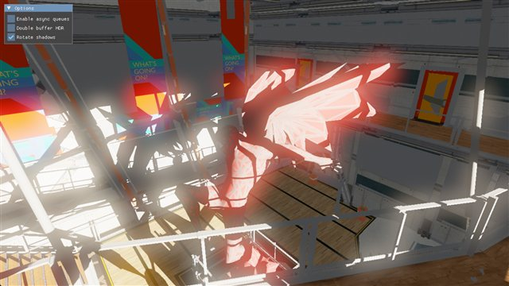</a><br><a href="examples/async_compute_bloom.ts"><b>Async Compute Bloom</b></a><br><sub>A 4K HDR forward pass with bloom computed on the async compute queue.</sub></td><td valign="top" width="33%"><a href="examples/oit_linked_lists.ts">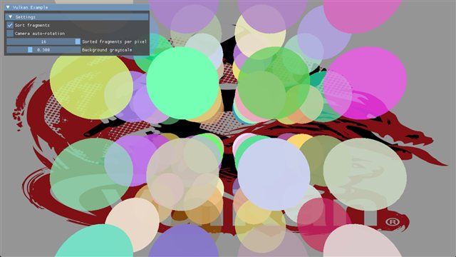</a><br><a href="examples/oit_linked_lists.ts"><b>OIT Linked Lists</b></a><br><sub>Order-independent transparency with per-pixel fragment linked lists.</sub></td></tr>
<tr><td valign="top" width="33%"><a href="examples/oit_depth_peeling.ts">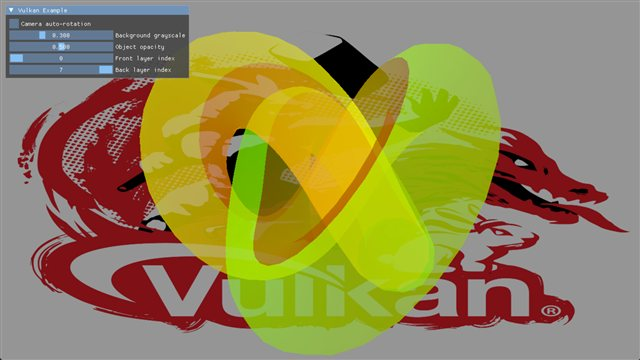</a><br><a href="examples/oit_depth_peeling.ts"><b>OIT Depth Peeling</b></a><br><sub>Order-independent transparency by depth peeling, up to 8 layers.</sub></td><td valign="top" width="33%"><a href="examples/gshader_to_mshader.ts">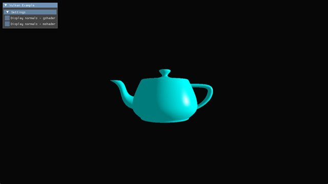</a><br><a href="examples/gshader_to_mshader.ts"><b>Geometry Shader to Mesh Shader</b></a><br><sub>Normals drawn by a geometry shader or by an equivalent mesh shader.</sub></td><td valign="top" width="33%"><a href="examples/mesh_shading.ts">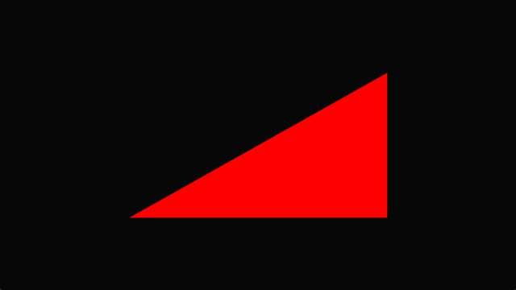</a><br><a href="examples/mesh_shading.ts"><b>Mesh Shading</b></a><br><sub>A single mesh shader workgroup outputs a triangle.</sub></td></tr>
<tr><td valign="top" width="33%"><a href="examples/mesh_shader_culling.ts">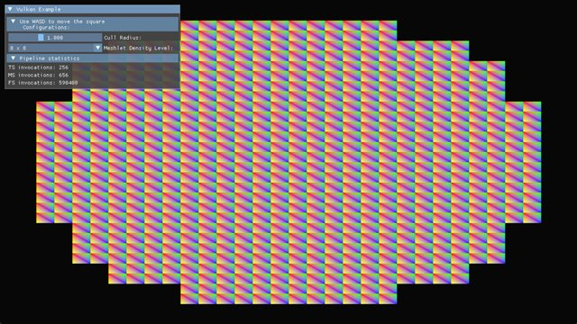</a><br><a href="examples/mesh_shader_culling.ts"><b>Mesh Shader Culling</b></a><br><sub>Task (amplification) shaders cull meshlets before mesh shading.</sub></td><td valign="top" width="33%"><a href="examples/sparse_image.ts">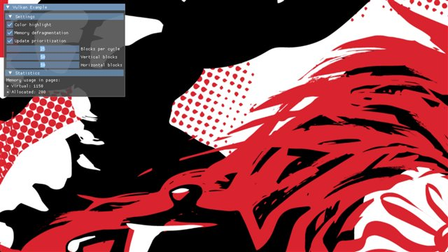</a><br><a href="examples/sparse_image.ts"><b>Sparse Image</b></a><br><sub>A huge texture whose pages are mapped and streamed in as the view needs them.</sub></td><td valign="top" width="33%"><a href="examples/conservative_rasterization.ts">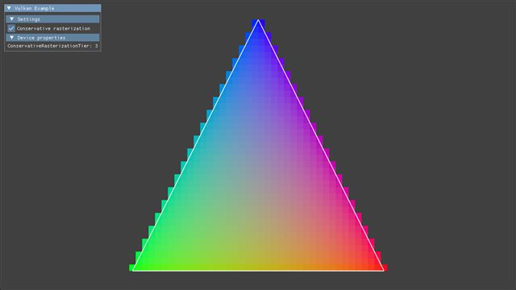</a><br><a href="examples/conservative_rasterization.ts"><b>Conservative Rasterization</b></a><br><sub>A low-resolution triangle with and without conservative rasterization.</sub></td></tr>
<tr><td valign="top" width="33%"><a href="examples/conditional_rendering.ts">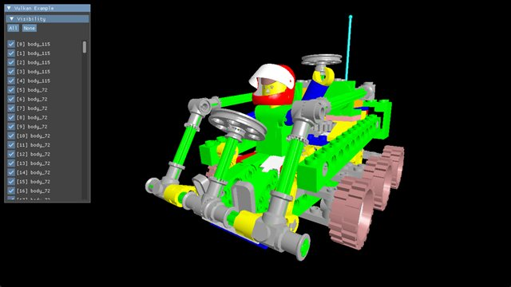</a><br><a href="examples/conditional_rendering.ts"><b>Conditional Rendering</b></a><br><sub>glTF nodes drawn or skipped by GPU predication.</sub></td><td valign="top" width="33%"><a href="examples/rasterization_order_attachment_access.ts">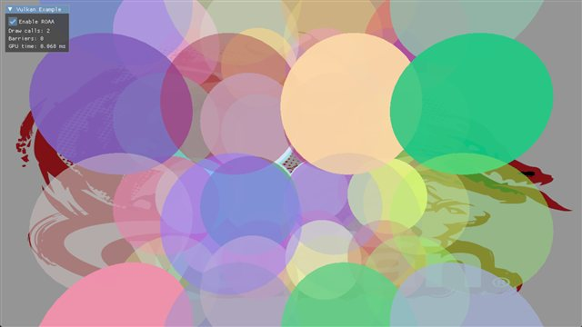</a><br><a href="examples/rasterization_order_attachment_access.ts"><b>Rasterization Order Attachment Access</b></a><br><sub>Programmable blending ordered by rasterizer ordered views / fragment shader interlock.</sub></td><td valign="top" width="33%"><a href="examples/fragment_shader_barycentric.ts">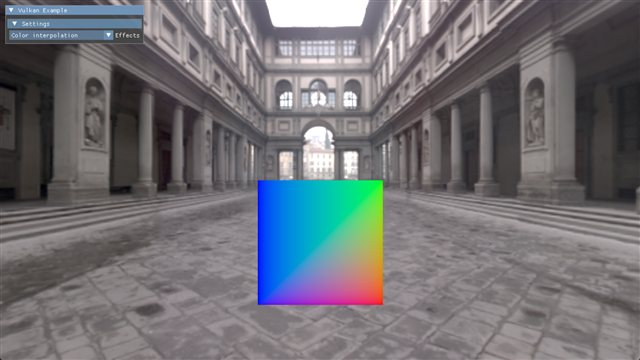</a><br><a href="examples/fragment_shader_barycentric.ts"><b>Fragment Shader Barycentric</b></a><br><sub>Pixel shaders reading barycentrics and per-vertex attributes.</sub></td></tr>
<tr><td valign="top" width="33%"><a href="examples/16bit_arithmetic.ts">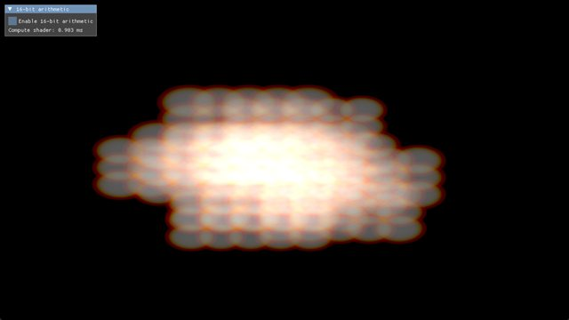</a><br><a href="examples/16bit_arithmetic.ts"><b>16-bit Arithmetic</b></a><br><sub>A compute shader rendering blobs in FP32 or native FP16.</sub></td><td valign="top" width="33%"><a href="examples/compute_shader_derivatives.ts">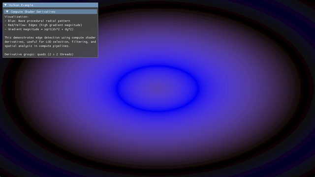</a><br><a href="examples/compute_shader_derivatives.ts"><b>Compute Shader Derivatives</b></a><br><sub>Derivatives in compute shaders (SM 6.6) to find a pattern's edges.</sub></td><td valign="top" width="33%"><a href="examples/logic_op_dynamic_state.ts">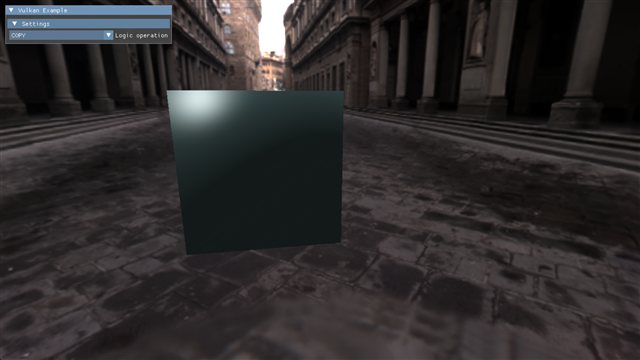</a><br><a href="examples/logic_op_dynamic_state.ts"><b>Logic Op Dynamic State</b></a><br><sub>A cube combined with the background by a framebuffer logic operation.</sub></td></tr>
<tr><td valign="top" width="33%"><a href="examples/render_octomap.ts">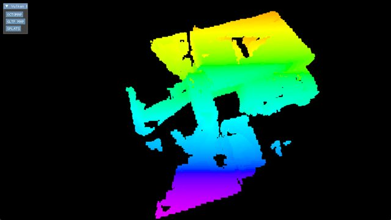</a><br><a href="examples/render_octomap.ts"><b>Render Octomap</b></a><br><sub>A SLAM map as instanced voxels, a glTF mesh and Gaussian splats.</sub></td><td valign="top" width="33%"><a href="examples/msaa.ts">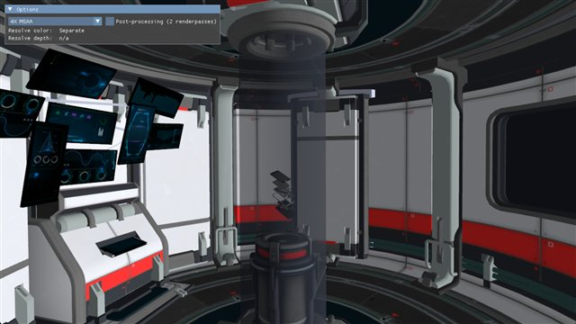</a><br><a href="examples/msaa.ts"><b>MSAA</b></a><br><sub>Multisample anti-aliasing with color and depth resolves.</sub></td><td valign="top" width="33%"><a href="examples/dynamic_blending.ts">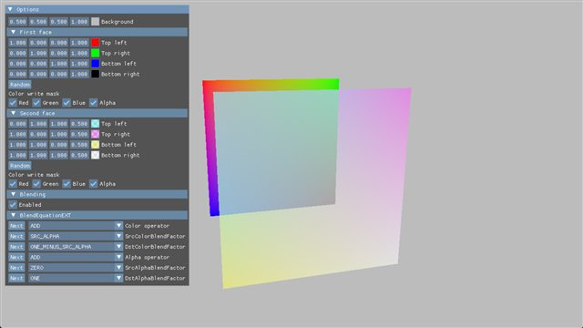</a><br><a href="examples/dynamic_blending.ts"><b>Dynamic Blending</b></a><br><sub>Blend state, advanced blend operations and color write masks switched live.</sub></td></tr>
<tr><td valign="top" width="33%"><a href="examples/texture_mipmap_generation.ts">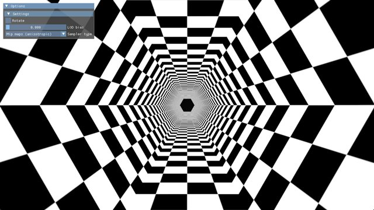</a><br><a href="examples/texture_mipmap_generation.ts"><b>Texture Mipmap Generation</b></a><br><sub>A mip chain generated on the GPU, compared with no mips and anisotropic filtering.</sub></td><td valign="top" width="33%"><a href="examples/fragment_shading_rate.ts">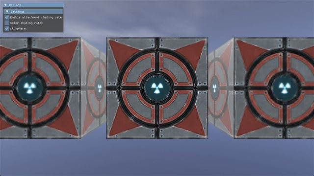</a><br><a href="examples/fragment_shading_rate.ts"><b>Fragment Shading Rate</b></a><br><sub>Variable rate shading from a CPU-made shading rate image.</sub></td><td valign="top" width="33%"><a href="examples/fragment_shading_rate_dynamic.ts">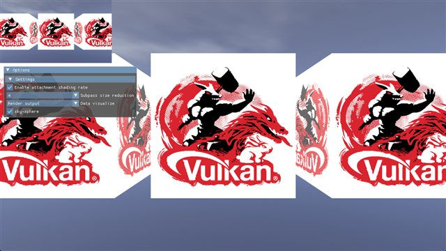</a><br><a href="examples/fragment_shading_rate_dynamic.ts"><b>Dynamic Fragment Shading Rate</b></a><br><sub>A shading rate image computed each frame from the scene's frequency content.</sub></td></tr>
<tr><td valign="top" width="33%"><a href="examples/texture_compression_comparison.ts">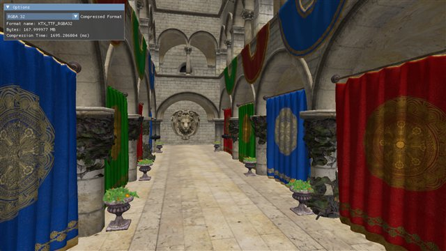</a><br><a href="examples/texture_compression_comparison.ts"><b>Texture Compression Comparison</b></a><br><sub>Sponza with Basis Universal KTX 2 textures transcoded at load into BC7, BC3 or RGBA8.</sub></td><td valign="top" width="33%"><a href="examples/texture_compression_basisu.ts">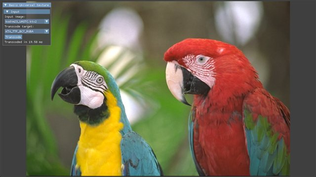</a><br><a href="examples/texture_compression_basisu.ts"><b>Basis Universal Textures</b></a><br><sub>UASTC and ETC1S KTX 2 images transcoded on the CPU, timed.</sub></td><td valign="top" width="33%"><a href="examples/shader_quad_control.ts">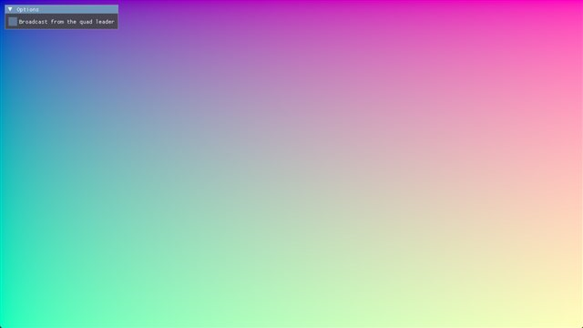</a><br><a href="examples/shader_quad_control.ts"><b>Shader Quad Control</b></a><br><sub>Pixel shaders running in full quads with quad operations.</sub></td></tr>
<tr><td valign="top" width="33%"><a href="examples/dynamic_line_rasterization.ts">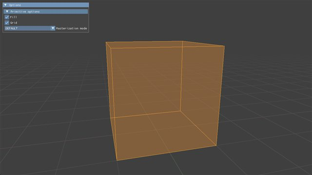</a><br><a href="examples/dynamic_line_rasterization.ts"><b>Dynamic Line Rasterization</b></a><br><sub>Rectangular, Bresenham and smooth lines with width and stipple.</sub></td><td valign="top" width="33%"><a href="examples/extended_dynamic_state2.ts">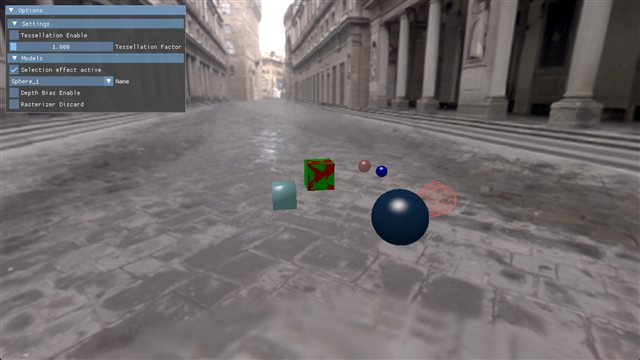</a><br><a href="examples/extended_dynamic_state2.ts"><b>Extended Dynamic State 2</b></a><br><sub>Depth bias, rasterizer discard and primitive restart switched live.</sub></td><td valign="top" width="33%"><a href="examples/memory_budget.ts"></a><br><a href="examples/memory_budget.ts"><b>Memory Budget</b></a><br><sub>Instanced rocks with the memory heaps' usage and budget.</sub></td></tr>
<tr><td valign="top" width="33%"><a href="examples/mobile_nerf.ts"></a><br><a href="examples/mobile_nerf.ts"><b>Mobile NeRF</b></a><br><sub>Neural radiance fields baked into meshes, decoded by a small MLP in the pixel shader.</sub></td><td valign="top" width="33%"><a href="examples/mobile_nerf_rayquery.ts"></a><br><a href="examples/mobile_nerf_rayquery.ts"><b>Mobile NeRF Ray Query</b></a><br><sub>MobileNeRF models found by inline ray queries instead of rasterization.</sub></td><td valign="top" width="33%"><a href="examples/dynamic_primitive_clipping.ts"></a><br><a href="examples/dynamic_primitive_clipping.ts"><b>Dynamic Primitive Clipping</b></a><br><sub>User clip distances (SV_ClipDistance) and depth clipping.</sub></td></tr>
<tr><td valign="top" width="33%"><a href="examples/timestamp_queries.ts"></a><br><a href="examples/timestamp_queries.ts"><b>Timestamp Queries</b></a><br><sub>GPU time of each render pass measured with timer queries.</sub></td><td valign="top" width="33%"><a href="examples/patch_control_points.ts"></a><br><a href="examples/patch_control_points.ts"><b>Patch Control Points</b></a><br><sub>Tessellated wireframe terrain with dynamic patch control points.</sub></td><td valign="top" width="33%"><a href="examples/descriptor_indexing.ts"></a><br><a href="examples/descriptor_indexing.ts"><b>Descriptor Indexing</b></a><br><sub>Bindless texture arrays: non-uniform indexing and update-after-bind.</sub></td></tr>
<tr><td valign="top" width="33%"><a href="examples/timeline_semaphore.ts"></a><br><a href="examples/timeline_semaphore.ts"><b>Timeline Semaphore</b></a><br><sub>Conway's Game of Life on the compute queue, drawn by the graphics queue.</sub></td><td valign="top" width="33%"><a href="examples/color_write_enable.ts"></a><br><a href="examples/color_write_enable.ts"><b>Color Write Enable</b></a><br><sub>Per-target color write enables combined into one image.</sub></td><td valign="top" width="33%"><a href="examples/dynamic_multisample_rasterization.ts"></a><br><a href="examples/dynamic_multisample_rasterization.ts"><b>Dynamic Multisample Rasterization</b></a><br><sub>The Space Module scene drawn with a sample count picked at run time.</sub></td></tr>
<tr><td valign="top" width="33%"><a href="examples/vertex_dynamic_state.ts"></a><br><a href="examples/vertex_dynamic_state.ts"><b>Vertex Dynamic State</b></a><br><sub>Two vertex layouts drawn with dynamic vertex input.</sub></td><td valign="top" width="33%"><a href="examples/dynamic_rendering.ts"></a><br><a href="examples/dynamic_rendering.ts"><b>Dynamic Rendering</b></a><br><sub>A reflective geosphere in a skybox, rendered without render pass objects.</sub></td><td valign="top" width="33%"><a href="examples/graphics_pipeline_library.ts"></a><br><a href="examples/graphics_pipeline_library.ts"><b>Graphics Pipeline Library</b></a><br><sub>Teapots, each with its own pipeline and a random lighting model; "Add pipeline" adds more.</sub></td></tr>
<tr><td valign="top" width="33%"><a href="examples/dynamic_uniform_buffers.ts"></a><br><a href="examples/dynamic_uniform_buffers.ts"><b>Dynamic Uniform Buffers</b></a><br><sub>125 cubes with model matrices in slices of one uniform buffer.</sub></td><td valign="top" width="33%"><a href="examples/texture_loading.ts"></a><br><a href="examples/texture_loading.ts"><b>Texture Loading</b></a><br><sub>A mipmapped texture with an adjustable level-of-detail bias.</sub></td><td valign="top" width="33%"><a href="examples/separate_image_sampler.ts"></a><br><a href="examples/separate_image_sampler.ts"><b>Separate Image Sampler</b></a><br><sub>A sampler bound apart from its image, linear or nearest filtering.</sub></td></tr>
<tr><td valign="top" width="33%"><a href="examples/dynamic_rendering_local_read.ts"></a><br><a href="examples/dynamic_rendering_local_read.ts"><b>Dynamic Rendering Local Read</b></a><br><sub>Deferred shading with 64 point lights, then forward-rendered glass.</sub></td><td valign="top" width="33%"><a href="examples/shader_object.ts"></a><br><a href="examples/shader_object.ts"><b>Shader Object</b></a><br><sub>Vertex, geometry and fragment shaders combined at draw time, then post-processed.</sub></td><td valign="top" width="33%"><a href="examples/calibrated_timestamps.ts"></a><br><a href="examples/calibrated_timestamps.ts"><b>Calibrated Timestamps</b></a><br><sub>The HDR scene with pieces of its code timed by the GPU clock through calibrated timestamps.</sub></td></tr>
<tr><td valign="top" width="33%"><a href="examples/host_image_copy.ts"></a><br><a href="examples/host_image_copy.ts"><b>Host Image Copy</b></a><br><sub>A textured cube whose texture the CPU writes straight into the image, no staging buffer.</sub></td><td valign="top" width="33%"><a href="examples/buffer_device_address.ts"></a><br><a href="examples/buffer_device_address.ts"><b>Buffer Device Address</b></a><br><sub>64 meshes animated and drawn through GPU pointers alone, no descriptors (Vulkan only).</sub></td><td valign="top" width="33%"><a href="examples/shader_debugprintf.ts"></a><br><a href="examples/shader_debugprintf.ts"><b>Shader debugprintf</b></a><br><sub>A vertex shader printing positions with printf, read back by the validation layer and shown in the UI (Vulkan only, with the Vulkan SDK).</sub></td></tr>
<tr><td valign="top" width="33%"><a href="examples/push_descriptors.ts"></a><br><a href="examples/push_descriptors.ts"><b>Push Descriptors</b></a><br><sub>Two crates whose descriptors are pushed into the command buffer with each draw, no descriptor sets (Vulkan only).</sub></td><td valign="top" width="33%"><a href="examples/descriptor_buffer_basic.ts"></a><br><a href="examples/descriptor_buffer_basic.ts"><b>Descriptor Buffers</b></a><br><sub>The same crates, their descriptor sets in buffers the CPU writes descriptors into, no pools (Vulkan only).</sub></td></tr>
</table>

### DirectX-Graphics-Samples ports

Ported from [Microsoft DirectX-Graphics-Samples](https://github.com/microsoft/DirectX-Graphics-Samples).

<table>
<tr><td valign="top" width="33%"><a href="examples/procedural_geometry.ts"></a><br><a href="examples/procedural_geometry.ts"><b>Raytracing Procedural Geometry</b></a><br><sub>Analytic shapes, metaballs, SDFs and a fractal intersected by intersection shaders.</sub></td><td valign="top" width="33%"><a href="examples/opacity_micromaps.ts"></a><br><a href="examples/opacity_micromaps.ts"><b>Raytracing Opacity Micromaps</b></a><br><sub>An alpha-tested tree whose leaves skip the any-hit shader thanks to opacity micromaps (DXR 1.2).</sub></td><td valign="top" width="33%"><a href="examples/wave_intrinsics.ts"></a><br><a href="examples/wave_intrinsics.ts"><b>SM6 Wave Intrinsics</b></a><br><sub>Wave intrinsics visualized per pixel: lane indices, reductions, prefix sums, quad shuffles.</sub></td></tr>
<tr><td valign="top" width="33%"><a href="examples/depth_bounds_test.ts"></a><br><a href="examples/depth_bounds_test.ts"><b>Depth Bounds Test</b></a><br><sub>A triangle clipped by an animated depth bounds test.</sub></td><td valign="top" width="33%"><a href="examples/predication_queries.ts"></a><br><a href="examples/predication_queries.ts"><b>Predication Queries</b></a><br><sub>A quad drawn only if last frame's occlusion query saw it.</sub></td><td valign="top" width="33%"><a href="examples/small_resources.ts"></a><br><a href="examples/small_resources.ts"><b>Small Resources</b></a><br><sub>77 small textures placed at 4 KB alignment vs committed at 64 KB.</sub></td></tr>
<tr><td valign="top" width="33%"><a href="examples/meshlet_render.ts"></a><br><a href="examples/meshlet_render.ts"><b>Meshlet Render</b></a><br><sub>The Stanford dragon drawn by a mesh shader alone, each meshlet in its own color.</sub></td><td valign="top" width="33%"><a href="examples/meshlet_cull.ts"></a><br><a href="examples/meshlet_cull.ts"><b>Meshlet Cull</b></a><br><sub>Amplification shaders cull meshlets by frustum and normal cone; a picked meshlet shows its bounding sphere and cone.</sub></td><td valign="top" width="33%"><a href="examples/meshlet_instancing.ts"></a><br><a href="examples/meshlet_instancing.ts"><b>Meshlet Instancing</b></a><br><sub>A cube of toy robots drawn by a mesh shader, several instances of each last meshlet packed into one group.</sub></td></tr>
<tr><td valign="top" width="33%"><a href="examples/dynamic_lod.ts"></a><br><a href="examples/dynamic_lod.ts"><b>Dynamic LOD</b></a><br><sub>Amplification shaders cull instances and pick one of six levels of detail by screen size.</sub></td><td valign="top" width="33%"><a href="examples/execute_indirect.ts"></a><br><a href="examples/execute_indirect.ts"><b>Execute Indirect</b></a><br><sub>A compute shader culls 1024 indirect draw commands; the draw takes their count from a buffer.</sub></td><td valign="top" width="33%"><a href="examples/dynamic_indexing.ts"></a><br><a href="examples/dynamic_indexing.ts"><b>Dynamic Indexing</b></a><br><sub>120 cities, each draw picking its material from an array of 120 textures.</sub></td></tr>
<tr><td valign="top" width="33%"><a href="examples/hdr_display.ts"></a><br><a href="examples/hdr_display.ts"><b>HDR Display</b></a><br><sub>SDR and HDR gradients and the Rec.709 / Rec.2020 gamuts on 8-bit sRGB, 10-bit ST.2084 or 16-bit scRGB swap chains.</sub></td><td valign="top" width="33%"><a href="examples/n_body_gravity.ts"></a><br><a href="examples/n_body_gravity.ts"><b>n-Body Gravity</b></a><br><sub>10,000 particles all pulling on each other: a compute shader on the async compute queue, drawn as geometry shader sprites.</sub></td><td valign="top" width="33%"><a href="examples/denoised_rtao.ts"></a><br><a href="examples/denoised_rtao.ts"><b>Denoised RTAO</b></a><br><sub>Ray traced AO at 1 ray per pixel, denoised spatio-temporally (temporal reprojection, a-trous filter) over PBRT models and animated grass.</sub></td></tr>
<tr><td valign="top" width="33%"><a href="examples/multithreading.ts"></a><br><a href="examples/multithreading.ts"><b>Multithreading</b></a><br><sub>A room of 1025 draws lit by three moving spotlights with PCF shadows, its shadow and scene passes recorded on three worker threads.</sub></td><td valign="top" width="33%"><a href="examples/bundles.ts"></a><br><a href="examples/bundles.ts"><b>Bundles</b></a><br><sub>30 cities drawn with two alternating pipeline states, from draws recorded once and replayed every frame (D3D12 bundles).</sub></td><td valign="top" width="33%"><a href="examples/raytracing_simple_lighting.ts"></a><br><a href="examples/raytracing_simple_lighting.ts"><b>Raytracing Simple Lighting</b></a><br><sub>A ray traced cube lit by a circling point light, the closest hit shader reading its 16-bit indices and vertex normals.</sub></td></tr>
<tr><td valign="top" width="33%"><a href="examples/reserved_resources.ts"></a><br><a href="examples/reserved_resources.ts"><b>Reserved Resources</b></a><br><sub>One level of a tiled texture at a time mapped to memory, picked with the arrow keys.</sub></td><td valign="top" width="33%"><a href="examples/raytracing_library_subobjects.ts"></a><br><a href="examples/raytracing_library_subobjects.ts"><b>Raytracing Library Subobjects</b></a><br><sub>A ray traced cube whose root signatures, hit group and configs are defined in its HLSL (D3D12 only).</sub></td><td valign="top" width="33%"><a href="examples/generic_programs.ts"></a><br><a href="examples/generic_programs.ts"><b>Generic Programs</b></a><br><sub>Two triangles drawn with generic programs: graphics pipelines made as state objects (D3D12 only).</sub></td></tr>
<tr><td valign="top" width="33%"><a href="examples/sakura_forest_ser.ts"></a><br><a href="examples/sakura_forest_ser.ts"><b>Sakura Forest SER</b></a><br><sub>A ray traced sakura forest whose primary rays go through hit objects and Shader Execution Reordering (D3D12 only).</sub></td><td valign="top" width="33%"><a href="examples/memory_management.ts"></a><br><a href="examples/memory_management.ts"><b>Memory Management</b></a><br><sub>Images streamed a mip level at a time under the memory budget: tiled resources, MakeResident / Evict, a paging thread (DirectX 12 only).</sub></td></tr>
</table>

### Xbox ATG Samples ports

Ported from [Microsoft Xbox-ATG-Samples](https://github.com/microsoft/Xbox-ATG-Samples).

<table>
<tr><td valign="top" width="33%"><a href="examples/fast_block_compress.ts"></a><br><a href="examples/fast_block_compress.ts"><b>Fast Block Compress</b></a><br><sub>BC1, BC3 and BC5 texture compression at run time in compute shaders or on the CPU.</sub></td><td valign="top" width="33%"><a href="examples/simple_hdr.ts"></a><br><a href="examples/simple_hdr.ts"><b>Simple HDR</b></a><br><sub>HDR10 output (Rec.2020, ST.2084) with blocks brighter than paper white.</sub></td><td valign="top" width="33%"><a href="examples/bokeh.ts"></a><br><a href="examples/bokeh.ts"><b>Bokeh</b></a><br><sub>Depth of field with bokeh sprites expanded by a geometry shader.</sub></td></tr>
<tr><td valign="top" width="33%"><a href="examples/raytracing_ao.ts"></a><br><a href="examples/raytracing_ao.ts"><b>Raytracing AO</b></a><br><sub>Ray traced ambient occlusion side by side with MiniEngine's SSAO.</sub></td><td valign="top" width="33%"><a href="examples/simple_pbr.ts"></a><br><a href="examples/simple_pbr.ts"><b>Simple PBR</b></a><br><sub>Physically based rendering with image based lighting and ACES tone mapping.</sub></td><td valign="top" width="33%"><a href="examples/simple_compute.ts"></a><br><a href="examples/simple_compute.ts"><b>Simple Compute</b></a><br><sub>A Mandelbrot fractal by a compute shader, synchronous or on the async compute queue.</sub></td></tr>
<tr><td valign="top" width="33%"><a href="examples/simple_bezier.ts"></a><br><a href="examples/simple_bezier.ts"><b>Simple Bezier</b></a><br><sub>A Mobius strip of Bezier patches tessellated by hull and domain shaders.</sub></td><td valign="top" width="33%"><a href="examples/mouse_cursor.ts"></a><br><a href="examples/mouse_cursor.ts"><b>Mouse Cursor</b></a><br><sub>Absolute, relative (captured) and custom mouse cursor modes.</sub></td><td valign="top" width="33%"><a href="examples/collision.ts"></a><br><a href="examples/collision.ts"><b>Collision</b></a><br><sub>DirectXMath collision tests between frustums, boxes, spheres, triangles and rays.</sub></td></tr>
<tr><td valign="top" width="33%"><a href="examples/video_texture.ts"></a><br><a href="examples/video_texture.ts"><b>Video Texture</b></a><br><sub>A video decoded by Media Foundation into a texture on a spinning cube.</sub></td></tr>
</table>

### NVIDIA DXR Tutorials port

Ported from [NVIDIA DxrTutorials](https://github.com/NVIDIAGameWorks/DxrTutorials).

<table>
<tr><td valign="top" width="33%"><a href="examples/dxr_refit.ts"></a><br><a href="examples/dxr_refit.ts"><b>DXR Refit</b></a><br><sub>Rotating triangles with shadow rays; the top-level acceleration structure refitted every frame.</sub></td></tr>
</table>

### Original examples

<table>
<tr><td valign="top" width="33%"><a href="examples/compute_nbody_collisions.ts"></a><br><a href="examples/compute_nbody_collisions.ts"><b>Compute N-Body Collisions</b></a><br><sub>compute_nbody with a third compute pass: particles bounce off each other.</sub></td><td valign="top" width="33%"><a href="examples/environment_map.ts"></a><br><a href="examples/environment_map.ts"><b>Environment Map</b></a><br><sub>Sponza under an environment map with planar shadow maps, DDS or KTX 2.</sub></td></tr>
</table>

## External assets

Some examples render scenes too large for this repository. Point CMake at a checkout of the
original samples' assets and they are copied (or converted to DDS) next to the executables at
build time:

| CMake variable | What it is | Examples that need it |
| --- | --- | --- |
| `DONUT_SAMPLES_MEDIA_DIR` | Donut-Samples `media` folder (glTF-Sample-Assets, fonts) | Sponza scenes, `feature_demo`, the ATG ports' text |
| `VULKAN_SAMPLES_ASSETS_DIR` | Khronos Vulkan-Samples `assets` folder | most Vulkan-Samples ports |
| `XBOX_ATG_SAMPLES_DIR` | Xbox-ATG-Samples checkout | `fast_block_compress`, `bokeh`, `raytracing_ao`, `simple_pbr`, `mouse_cursor`, `video_texture` |
| `DIRECTX_GRAPHICS_SAMPLES_DIR` | DirectX-Graphics-Samples checkout | `opacity_micromaps`, `meshlet_render`, `meshlet_cull`, `meshlet_instancing`, `dynamic_lod`, `dynamic_indexing`, `denoised_rtao`, `multithreading`, `bundles`, `sakura_forest_ser` (a checkout from August 2025 or later), `memory_management` (its TileGrid.dds; without it, only the generated images) |

```
cmake --preset default -DVULKAN_SAMPLES_ASSETS_DIR=E:/Vulkan-Samples/assets
```

## Repository layout

```
native_ts_graphics/
├── CMakeLists.txt        # the TSLANG language, Donut, and one add_tslang_example() per example
├── CMakePresets.json     # default, release, dlss, android-x86_64, android-arm64, android-arm32
├── cmake/                # CMake language support for .ts (CMakeDetermineTSLANGCompiler.cmake, ...)
├── core/                 # donut.ts (TypeScript classes) over donut_interop.cpp (flat C API over Donut);
│                         # nvrhi.ts: NVRHI's interfaces, called directly
├── examples/             # one .ts file per example
├── shaders/              # HLSL shaders and ShaderMake configs, compiled to DXIL, DXBC and SPIR-V
├── media/                # small assets shipped with the repository
├── patches/              # local patches to Donut, NVRHI and GLFW
├── tools/                # Android build/test script, smoke test, screenshot capture, asset tools
└── external/Donut        # NVIDIA Donut (submodule)
```

## How the TypeScript build works

The project registers a CMake *language* (`TSLANG`) that:

- owns its own source extension (`.ts`),
- is built with **tslang --emit=obj**,
- produces `.obj` files that CMake links automatically alongside regular C++.

CMake then handles dependency tracking and incremental builds for `.ts` sources the same way it
does for `.cpp`.

- `enable_language(TSLANG)` runs `CMakeDetermineTSLANGCompiler.cmake`, which finds `tslang`, then
  loads `CMakeTSLANGInformation.cmake`, which registers the compile rule
  (`CMAKE_TSLANG_COMPILE_OBJECT` — *tslang --emit=obj*).
- Because `CMAKE_TSLANG_SOURCE_FILE_EXTENSIONS` contains `ts`, any `.ts` source is routed to
  tslang and compiled to a `.obj`.
- That `.obj` is added to the target and linked with the C++ objects using the C++ linker
  (`CMAKE_TSLANG_LINK_EXECUTABLE`).
- Change one example's `.ts` and only it recompiles.
- tslang can't write a depfile, so the files a `.ts` imports or references aren't tracked for it:
  list them as its `OBJECT_DEPENDS`, as `CMakeLists.txt` does for `core/`.

The examples can also run under tslang's JIT, against the shared build of the interop layer
(`run_jit.bat examples/<name>.ts [-- args]` does this from the repo root):

```
tslang --emit=jit --shared-libs=build/bin/donut_interop.dll examples/basic_triangle.ts -- -dx12
```

- Program arguments go after `--`.
- The JIT caches each compiled module in a `__jit` folder next to its source (ignored by git). A
  module is compiled again when it, a file it imports, its options or tslang change. Needs
  pre-alpha94 or later: pre-alpha93's cache crashed a run that compiled two or more modules
  ([TypeScriptCompiler#548](https://github.com/ASDAlexander77/TypeScriptCompiler/pull/548)).
- The shared library also holds the C++ modules some examples link (`core/sdkmesh.cpp`,
  `core/meshlet_model.cpp`, `core/paged_images.cpp`, ...), and applies the D3D12 Agility SDK
  runtime from `bin/D3D12` (the executables that need it opt in through their exports, which
  `tslang.exe` doesn't have).

### Passing flags

```cmake
set(CMAKE_TSLANG_FLAGS "--opt_level=3")                       # global
set_source_files_properties(mycode.ts PROPERTIES
    COMPILE_OPTIONS "--define;TSLANG=1")                      # per-file
```

### Using it without a first-class language

If you don't need a first-class language, either:

- Mark a file as an already-built object and just link it:
  `set_source_files_properties(mycode.obj PROPERTIES EXTERNAL_OBJECT TRUE GENERATED TRUE)`
  and add it to `add_executable`, producing it with `add_custom_command`; or
- Compile a differently-named file *as C++*:
  `set_source_files_properties(mycode.tslang PROPERTIES LANGUAGE CXX)`.

Use the `TSLANG` language setup when `.ts` is a source type you compile often and want CMake to
treat as first-class.

## Calling NVRHI directly

The examples reach Donut and NVRHI through `core/donut_interop.cpp`, a flat C API. `core/nvrhi.ts`
skips it for NVRHI's interfaces: `nvrhi.IDevice`, `ICommandList`, `IBuffer`, `ITexture`, `IShader`,
`IBindingLayout`, `IBindingSet` and `IComputePipeline`, over `IResource`, are tslang `@cppvtable`
classes, laid over the C++ objects. A method call goes through the C++ object's own vtable.
Donut's handles are the same objects' pointers, so the two mix: `<nvrhi.IBuffer><Opaque>bufferHandle`
and back.

The vtables and some struct layouts depend on the C++ ABI, so the `nvrhi` namespace is three
modules, as tslang's default library is `lib.ts` and `lib.<os>.ts`:

| Module | Holds |
| --- | --- |
| `core/nvrhi_types.ts` | the structs and constants every ABI lays out the same way |
| `core/nvrhi_abi.win32.ts` | the classes and `std::string` structs of MSVC x64 (the release CRT) |
| `core/nvrhi_abi.linux.ts` | the same for the Itanium ABI of Android's clang and libc++ (x86-64, AArch64) |
| `core/nvrhi.ts` | the functions; it imports `./nvrhi_abi`, which tslang resolves to the target's file |

An example imports `../core/nvrhi` and lists `${NVRHI_TS_SOURCES}` in its `add_tslang_example`
sources. This needs a tslang newer than pre-alpha94, for `<name>.<os>.ts` imports and Itanium struct
returns.

```ts
import { nvrhi } from "../core/nvrhi";

const device = <nvrhi.IDevice>app.getNvrhiDevice();
const commandList = nvrhi.createCommandList(device, nvrhi.commandListParameters());
if (commandList) {
    commandList.open();
    nvrhi.setComputeState(commandList, nvrhi.computeState(pipeline, bindingSet));
    commandList.dispatch(1, 1, 1);
    commandList.close();
    nvrhi.executeCommandList(device, commandList);
    commandList.Release();
}
```

- **Slot order.** A `@cppvtable` class's methods are the vtable's slots in declaration order, a
  base class's first. Every slot is declared, because a missing one would call a different C++
  method with no error. MSVC has one destructor slot, the Itanium ABI two. Run
  `python tools/check_nvrhi_slots.py` (needs MSVC) and `python tools/check_nvrhi_slots.py --abi itanium`
  (needs the Android NDK) after changing the classes or updating NVRHI: they compare the classes
  with the vtables the compilers build.
- **Bound methods.** Only the methods `examples/nvrhi_direct.ts` tests have signatures; the other
  slots are placeholders named `_` + the C++ name.
- **Signatures.** An object returned by value is a tuple with its layout: `RefCountPtr<T>`
  (`@cppnontrivial`, as it has a destructor) and `nvrhi::Object`. tslang passes the hidden pointer
  each ABI returns it through; `nvrhi.createBuffer()` and the other functions unwrap it. A struct
  passed by reference is a `Ref` to a tuple with the C++ layout (`BufferDesc`, `TextureDesc`,
  `ComputePipelineDesc`, `ComputeState`, ...). That layout depends on the C++ build (`std::string`'s
  on the C++ library), so `nvrhi.layoutMatches()` compares the tuples' sizes with the C++ ones. A
  struct passed by value is the ABIs' difference: MSVC passes a pointer to a copy, the Itanium ABI
  the fields in registers (`clearTextureFloat`'s `TextureSubresourceSet`, see the two files).
- **Callbacks.** `nvrhi.IMessageCallback` goes the other way: a `@cppvtable` class extending it
  whose `message()` has a body is an object NVRHI calls, through the vtable tslang makes for it.
  Pass it to `Donut_SetNvrhiMessageCallback` before creating the app, and keep it in a global
  while the device lives. `Donut_LogNvrhiMessage` passes a message on to Donut's logging.
  `nvrhi_direct` does this.
- **Platform.** `nvrhi.supported()` says whether the build has one of the two ABIs (MSVC x64,
  Android's clang on x86-64 or AArch64) and their layouts: code that also runs elsewhere keeps
  another path.

`headless` calls NVRHI directly where `nvrhi.supported()`, as the C++ sample does, and through
Donut's wrappers elsewhere or with `-donut`. CTest runs both: `headless.<api>` and
`headless.donut.<api>`.

`nvrhi_direct` is a headless test of every bound method, not a sample; on Android it runs through
`adb shell`, as `headless` does. One command list:
1. uploads numbers into a buffer and clears another;
2. runs a compute shader over the uploaded numbers (its pipeline made directly, its binding set by
   Donut);
3. copies the three into a readback buffer, the last copy with hand-made barriers;
4. clears a texture, read back through Donut.

It checks what it reads. On the way it also checks:
- the graphics API, the native objects and queues;
- reference counting, debug names, the descs NVRHI keeps and the struct layouts;
- NVRHI's messages, which go through an `IMessageCallback` implemented in tslang. With `-debug`,
  it provokes a validation error and checks that NVRHI called the callback.

## Memory model

The default library is compiled separately for each memory model, and a program has to link
the build matching the model it was compiled with. One variable drives both:

```
cmake --preset default -DTSLANG_MEMORY_MODEL=rc
```

It selects `defaultlib/lib/<target>/<debug|release>/<model>` (on Windows
`defaultlib/lib/x86_64/pc/windows/msvc/release/gc`, as `tslang --print-default-lib-dir=lib` names
it) as the link directory and adds `-mm=<model>` to the compile flags, so the two cannot disagree.
Valid values are `gc` (default), `rc` and `none`; only `gc` links Boehm.

## Android

The `android-x86_64` (emulator), `android-arm64` (devices) and `android-arm32` (32-bit devices,
`armeabi-v7a`) presets cross-compile with the Android NDK for API 29, Vulkan only. `tools/android.py` builds them, starts an emulator, and runs
and tests the examples on it; what it does by hand is under *Without the script*.

### What to install

- the Android NDK (r30 is the one tested), in `ANDROID_NDK_HOME`;
- the Android SDK, in `ANDROID_HOME` (or next to the NDK): platform-tools, build-tools,
  platform 29, and for an emulator the emulator, an x86_64 system image and a virtual device:

  ```
  sdkmanager "platform-tools" "build-tools;35.0.0" "platforms;android-29" "emulator" "system-images;android-34;google_apis;x86_64"
  avdmanager create avd -n api34_x86_64 -k "system-images;android-34;google_apis;x86_64"
  ```

  The API 34 Google APIs image also runs arm64 apps, translated (simple ones: `feature_demo`
  crashes the emulator);
- a JDK (17 or later) for signing, in `JAVA_HOME` (or in `jdk/` next to the SDK);
- Python 3, and the Vulkan SDK (`VULKAN_SDK`) for DXC;
- tslang with its Android libraries, `<tslang>/android/<abi>/lib`.

Shaders are compiled at build time by ShaderMake, which has to run on this machine, so the
Android build takes the desktop build's `build-release/bin/ShaderMake.exe` (or
`DONUT_HOST_SHADERMAKE`). The script builds it if it isn't there, in the Visual Studio
environment.

### Build and test

```
python tools/android.py build
python tools/android.py emulator
python tools/android.py test
```

- `build` configures `build-android-x86_64` if it isn't, and builds `headless` and every
  example's APK, `bin/<example>.apk`; name examples to build only theirs
  (`build basic_triangle vertex_buffer`), and `--abi arm64` builds for devices.
- `emulator` starts the newest virtual device (`--avd <name>` picks one, `--no-window` hides
  it) unless a device is connected, and waits for it to boot. `adb emu kill` stops it.
- `test` runs `headless`, then installs and starts each example: it has to be running after 20 s
  (`--seconds`), and to close without a crash on Back. Screenshots and logs go to
  `build-android-x86_64/android-test`. With no examples named, it tests the ones that run on the
  emulator: 65 of them (`EMULATOR_EXAMPLES` in `tools/android.py`). Its Vulkan is lavapipe, on the
  CPU, so the others, which need ray tracing, mesh shaders, variable rate shading, conditional
  rendering, push descriptors, descriptor buffers, sparse or reserved resources and the like, stop
  at once with a message saying what the device lacks (`test` reports them as failures; they
  are for devices).
- `run <example>` installs and starts one and follows its log (Ctrl+C stops following);
  `--screenshot shot.png` takes a screenshot instead. `headless` runs headless alone.

`test`, `run` and `headless` start an emulator themselves if no device is connected; with more
than one, pass `--serial`. On a phone: enable USB debugging, `build --abi arm64`, and
`test --abi arm64 <examples>`.

`--abi arm32` builds `armeabi-v7a`. It needs a tslang release carrying the armeabi-v7a collector,
async runtime and default library (`android/armeabi-v7a/lib`, `defaultlib/lib/arm`). It has no
`headless` or `nvrhi_direct`: tslang cannot call C++ vtables that return structs on 32-bit ARM, so
`core/nvrhi.ts` is not built there (the other examples go through Donut's wrappers). Donut needs
Vulkan 1.3, which many 32-bit-only devices lack (a Galaxy Tab A 10.1 reports 1.1: the app starts,
creates its Vulkan instance and stops there). So far it has only been built and started on that
device: no frame has been rendered on 32-bit ARM, and only `basic_triangle` has been built.

### How the examples run

Each example is an app, `<example>_apk` (not built by default): `bin/<example>.apk`, a
NativeActivity running `lib<example>.so` (the example with `core/android_main.cpp`), with its
shaders and the media its `add_tslang_example(<example> MEDIA ...)` lists (the files and folders
of `media/` it reads), signed with a debug key made in the build folder (an app installed from
another build folder has to be uninstalled first; the script does that). Packaging
(`tools/package_apk.py`) needs the SDK's build tools and platform 29 (`ANDROID_HOME`, or the SDK
next to the NDK, or `ANDROID_SDK_DIR`), a JDK (`JAVA_HOME`, or `ANDROID_JAVA_HOME`) and Python.
`rt_reflections` has no APK that builds: it is D3D12-only.

The window is the activity's, through GLFW's Android platform
(`patches/glfw-android-platform.patch`): touch drives the mouse cursor and left button, Back is
Escape, and the display density is the content scale. What the examples print goes to logcat
under their name. An example runs once per process: Back, or the activity leaving the screen,
closes it and the process exits. Their shaders and media are extracted into the app's storage on
the first start after an install.

The default library comes from tslang's tree for the Android triple; the collector and the async
runtime from `<tslang>/android/<abi>/lib` (`TSLANG_ANDROID_LIB_DIR`).

### Without the script

With `ANDROID_NDK_HOME` set, and `adb` and `emulator` (the SDK's `platform-tools` and `emulator`)
on the `PATH`:

```
cmake --preset android-x86_64
cmake --build --preset android-x86_64 --target headless basic_triangle_apk

emulator -avd api34_x86_64 -no-audio -no-boot-anim
adb wait-for-device

adb install -r build-android-x86_64/bin/basic_triangle.apk
adb shell am start -n org.native_ts_graphics.basic_triangle/android.app.NativeActivity
adb logcat -s basic_triangle DEBUG
adb exec-out screencap -p > shot.png
adb shell am force-stop org.native_ts_graphics.basic_triangle
```

`headless` needs no window and runs as a plain executable, next to its shaders as in `bin/`:

```
adb shell mkdir -p /data/local/tmp/native_ts_graphics/shaders
adb push build-android-x86_64/bin/headless /data/local/tmp/native_ts_graphics/
adb push build-android-x86_64/bin/shaders/framework build-android-x86_64/bin/shaders/headless /data/local/tmp/native_ts_graphics/shaders/
adb shell "cd /data/local/tmp/native_ts_graphics && chmod +x headless && ./headless"
```

It prints `Test PASSED`. A native crash shows in logcat under `DEBUG`; the APKs hold a stripped
library, and the build folder's `android/<example>/lib<example>.so` keeps the symbols for
`ndk-stack -sym build-android-x86_64/android/<example>`.

## Tests

Examples with a test mode run headless under CTest, on D3D12 and Vulkan with the debug layers:

```
ctest --test-dir build
ctest --test-dir build -R meshlet_render -L vk --output-on-failure
```

`<example> -test` creates the device without a window, renders a fixed number of frames at a fixed
time step into offscreen back buffers, reads the last one back and checks it (the clear color where
nothing is drawn, where the geometry lands, what it is shaded with), printing `Test PASSED` or
`Test FAILED: <why>`; `-testOutput <file.png>` also saves that frame. A test fails on a non-zero
exit code or an error line from Donut, NVRHI or the API's validation layer. `headless` (and
`headless.donut`, its Donut path) and `nvrhi_direct` are tests too.

The other examples are covered by a smoke test, and the gallery has its own script:

```
pwsh -File tools/smoke_examples.ps1 [-Examples basic_triangle,compute_nbody] [-Apis dx12,vk]
pwsh -File tools/capture_screenshots.ps1 [-Examples basic_triangle,compute_nbody] [-Api dx12]
```

`smoke_examples.ps1` starts each built example on each API with the debug layers and reports
crashes and validation errors. `capture_screenshots.ps1` regenerates the gallery images in
`docs/screenshots`. Both open real windows: leave the desktop alone while they run, as an example
renders only while its window has focus.

## Credits

- [NVIDIA Donut](https://github.com/NVIDIA-RTX/Donut), [NVRHI](https://github.com/NVIDIA-RTX/NVRHI)
  and [Donut-Samples](https://github.com/NVIDIA-RTX/Donut-Samples)
- [Khronos Vulkan-Samples](https://github.com/KhronosGroup/Vulkan-Samples)
- [Microsoft DirectX-Graphics-Samples](https://github.com/microsoft/DirectX-Graphics-Samples)
  and [Xbox-ATG-Samples](https://github.com/microsoft/Xbox-ATG-Samples)
- [NVIDIA DXR Tutorials](https://github.com/NVIDIAGameWorks/DxrTutorials)
- [tslang, the TypeScript native compiler](https://github.com/ASDAlexander77/TypeScriptCompiler)

Each port keeps the original sample's algorithm and look; see the comment above its
`add_tslang_example` in `CMakeLists.txt` for what differs.
